# Evaluación Parcial N°2 — Infraestructura Serverless (INY1106)

**Asignatura:** Infraestructura de Aplicaciones II (`INY1106`)  
**Estudiante:** Fernando Galdámez (`fer.galdamez@duocuc.cl`)  
**Arquitectura:** Serverless Image Metadata API en AWS (`us-east-1`)  
**Herramientas IaC y Runtime:** Terraform v1.16+ | AWS Lambda Python 3.11 | Amazon S3 | Amazon DynamoDB | Amazon API Gateway | Amazon CloudWatch  

---

## 1. Arquitectura de la Solución

La solución implementa una API REST Serverless que permite cargar imágenes en formato JPEG hacia un bucket de **Amazon S3**, registrar automáticamente sus metadatos en una tabla NoSQL de **Amazon DynamoDB** y consultar dichos metadatos mediante su identificador único (`image_id`) a través de **Amazon API Gateway** y funciones **AWS Lambda** ejecutadas con el rol institucional `LabRole`.

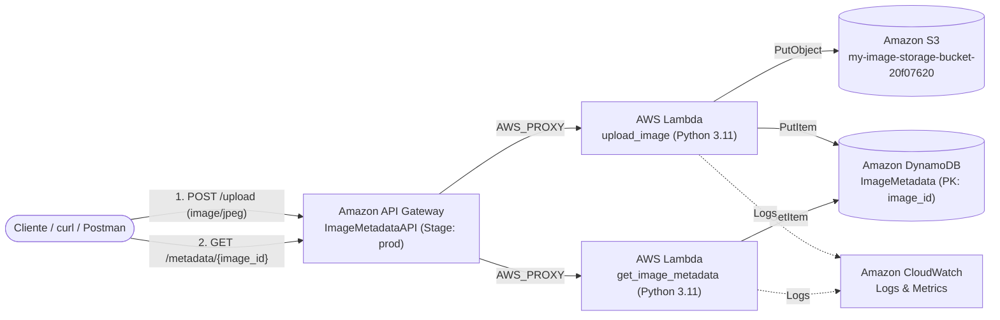

---

## 2. Paso a Paso de la Implementación y Evidencias

### Fase 1: Almacenamiento y Base de Datos (IE2.2.1 e IE2.2.2)

1. **Creación del Bucket en Amazon S3 (`IE2.2.1`):**
   - Se aprovisionó el bucket con nombre único global `my-image-storage-bucket-20f07620` en la región `us-east-1`, aplicando bloqueo de acceso público por defecto para asegurar el almacenamiento privado de objetos.

   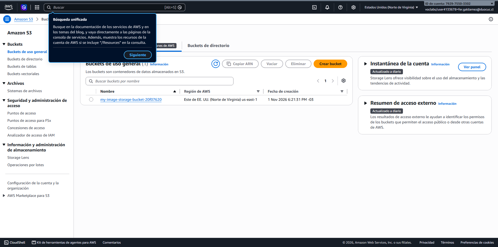

2. **Creación de la Tabla en Amazon DynamoDB (`IE2.2.2`):**
   - Se desplegó la tabla `ImageMetadata` configurada con clave de partición (*Partition Key*) `image_id` de tipo `String (S)` y modo de capacidad **Bajo demanda (`PAY_PER_REQUEST`)**, permitiendo escalabilidad automática sin sobreaprovisionamiento.

   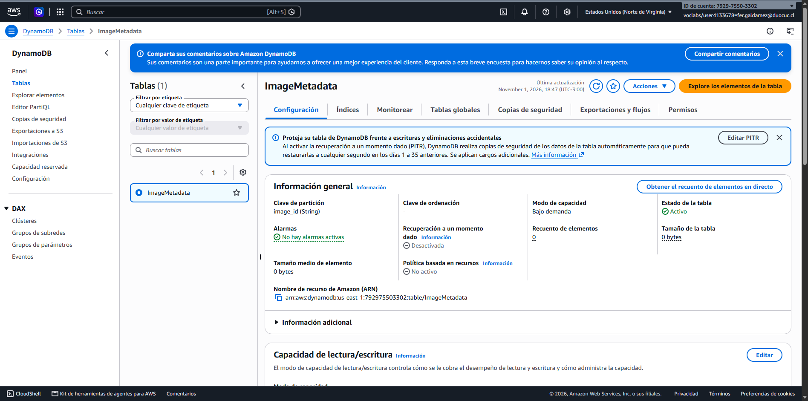

---

### Fase 2: Cómputo Serverless — Funciones AWS Lambda (IE2.1.1)

Se implementaron dos funciones en **Python 3.11**, asociadas al rol existente `LabRole` (`arn:aws:iam::792975503302:role/LabRole`) y con un **Timeout de 30 segundos**:

1. **Listado de Funciones Desplegadas:**

   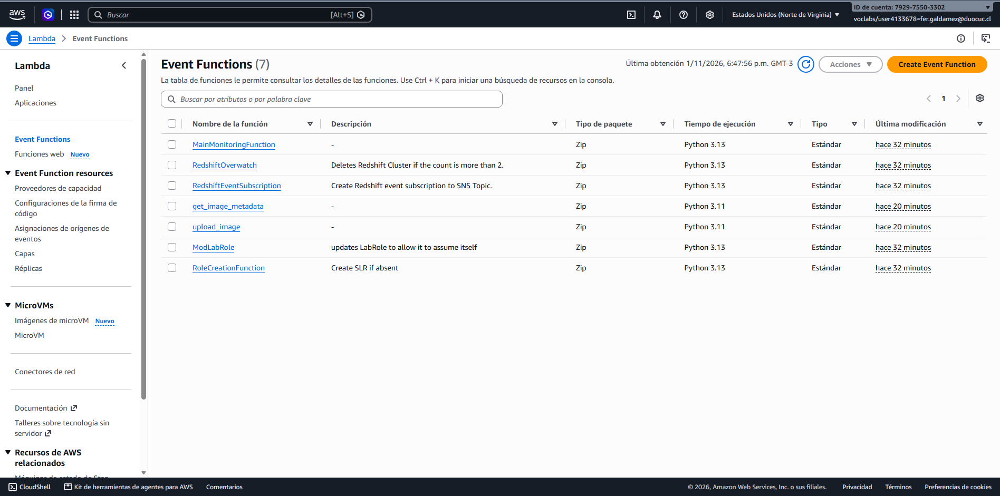

2. **Función `upload_image`:**
   - Recibe el cuerpo de la imagen (binario/base64 desde API Gateway), genera un identificador UUIDv4 único, almacena el objeto bajo el prefijo `images/{image_id}.jpg` en S3 y guarda los metadatos (`image_id`, `bucket_name`, `s3_key`, `size_bytes`, `upload_date`) en DynamoDB.
   - **Configuración General (Timeout 30s, Memoria 128 MB):**

     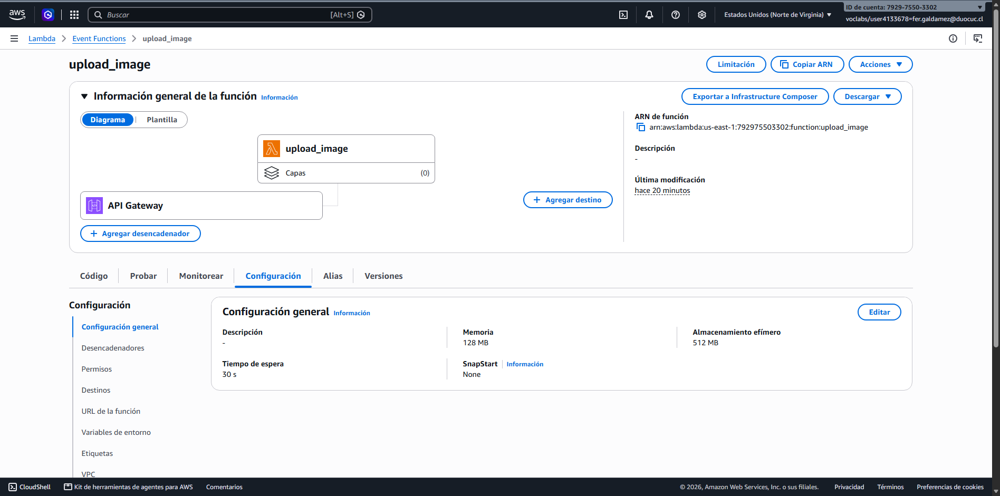

   - **Variables de Entorno (`BUCKET_NAME` y `TABLE_NAME`):**

     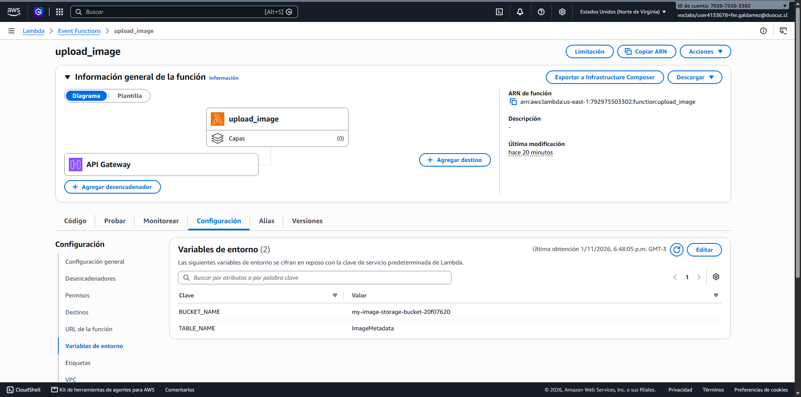

3. **Función `get_image_metadata`:**
   - Extrae el parámetro de ruta `{image_id}`, realiza la lectura eficiente mediante `GetItem` sobre la tabla `ImageMetadata` en DynamoDB y retorna el objeto JSON con código de estado HTTP `200`.
   - **Configuración General (Timeout 30s, Memoria 128 MB):**

     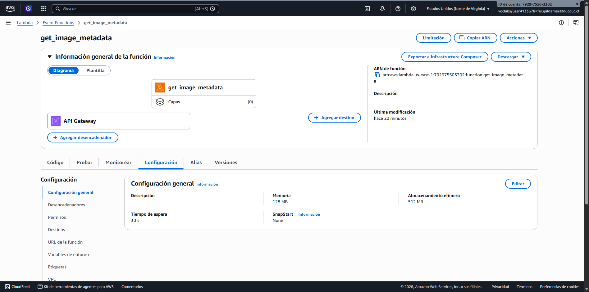

---

### Fase 3: Configuración de Amazon API Gateway (IE2.2.3)

Se configuró la API REST regional llamada **`ImageMetadataAPI`** (ID: `9xl860sgs4`) con soporte para tipos de medios binarios (`image/jpeg` y `*/*`) e integración `AWS_PROXY`:

1. **API REST `ImageMetadataAPI` creada:**

   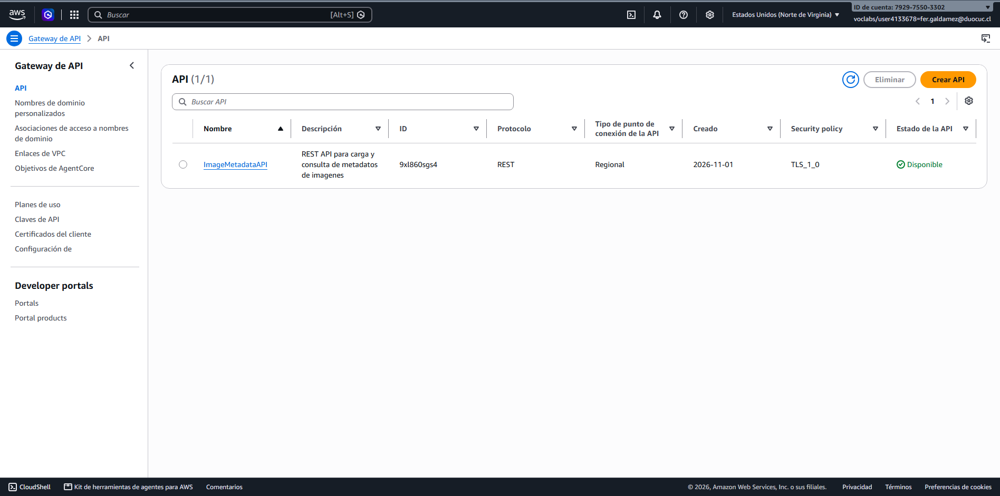

2. **Endpoints y Métodos Configurados (`POST /upload` y `GET /metadata/{image_id}`):**

   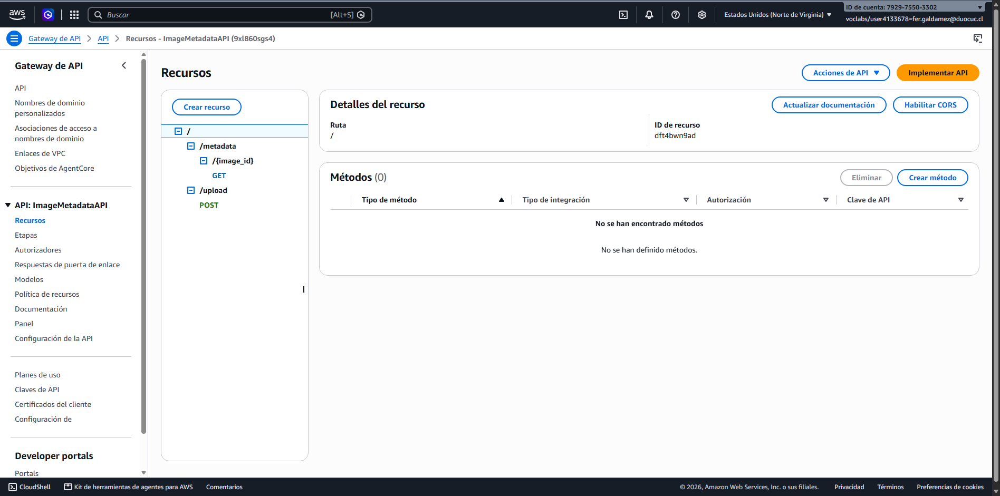

3. **Despliegue en Etapa `prod`:**
   - **URL de invocación:** `https://9xl860sgs4.execute-api.us-east-1.amazonaws.com/prod`

   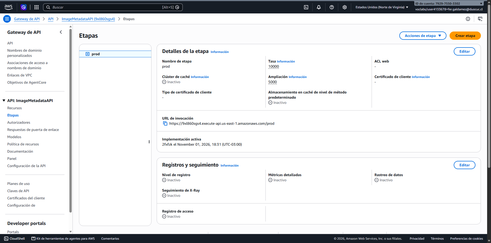

---

### Fase 4: Pruebas de Funcionamiento de la API (IE2.3.1)

#### 1. Prueba de subida de imagen (`POST /upload`)
Comando ejecutado:
```bash
curl -X POST https://9xl860sgs4.execute-api.us-east-1.amazonaws.com/prod/upload \
  -H "Content-Type: image/jpeg" \
  --data-binary "@test_image.jpg"
```
Respuesta obtenida (`HTTP 200 OK`):
```json
{
  "image_id": "a26f5583-b891-4666-bc67-81cebac0319c",
  "bucket_name": "my-image-storage-bucket-20f07620",
  "s3_key": "images/a26f5583-b891-4666-bc67-81cebac0319c.jpg",
  "size_bytes": 137,
  "upload_date": "2026-11-01T21:34:53.570136+00:00"
}
```

#### 2. Prueba de obtención de metadatos (`GET /metadata/{image_id}`)
Comando ejecutado:
```bash
curl -X GET https://9xl860sgs4.execute-api.us-east-1.amazonaws.com/prod/metadata/a26f5583-b891-4666-bc67-81cebac0319c
```
Respuesta obtenida (`HTTP 200 OK`):
```json
{
  "image_id": "a26f5583-b891-4666-bc67-81cebac0319c",
  "bucket_name": "my-image-storage-bucket-20f07620",
  "s3_key": "images/a26f5583-b891-4666-bc67-81cebac0319c.jpg",
  "size_bytes": "137",
  "upload_date": "2026-11-01T21:34:53.570136+00:00"
}
```

#### 3. Verificación en Consola de S3 y DynamoDB:
- **Carpeta `images/` generada en el bucket S3:**

  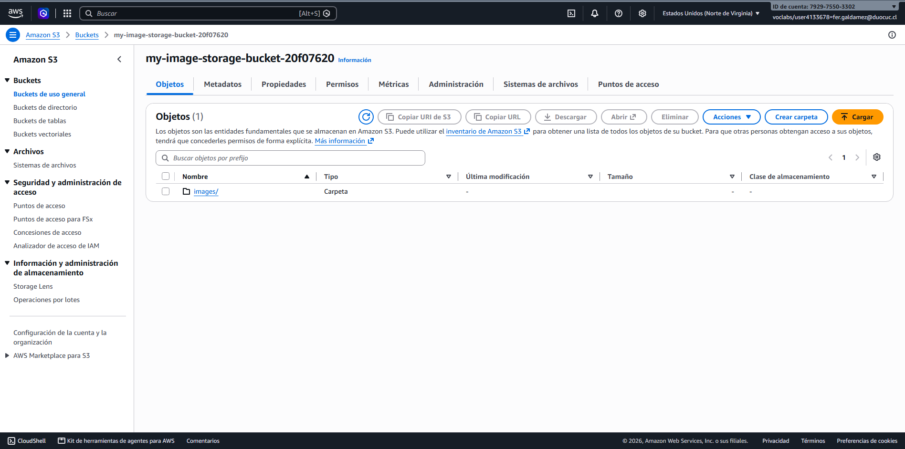

- **Objeto `a26f5583-b891-4666-bc67-81cebac0319c.jpg` almacenado en S3:**

  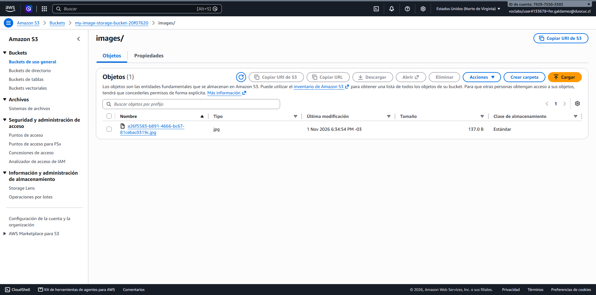

- **Ítem persistido en la tabla `ImageMetadata` de DynamoDB:**

  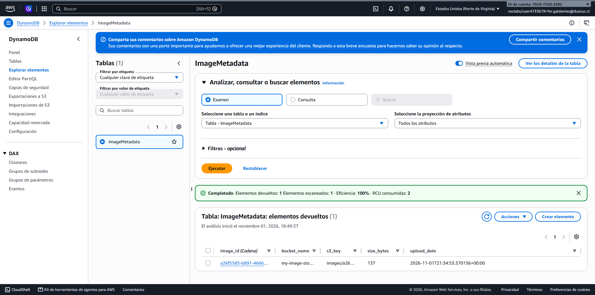

---

### Fase 5: Monitoreo, Troubleshooting y Optimización del Rendimiento (IE2.3.2)

#### 1. Grupos de Registros en Amazon CloudWatch
Ambas funciones registran sus eventos de invocación en CloudWatch Logs bajo `/aws/lambda/upload_image` y `/aws/lambda/get_image_metadata`:

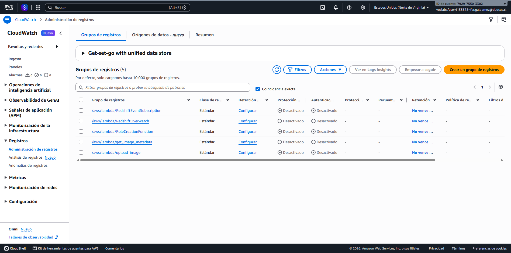

#### 2. Métricas de Ejecución Extraídas de CloudWatch Logs
```text
# /aws/lambda/upload_image
REPORT RequestId: 32fcf9f8-4749-4e84-8e10-382c88b83780
Duration: 408.78 ms | Billed Duration: 925 ms | Memory Size: 128 MB | Max Memory Used: 94 MB | Init Duration: 515.88 ms

# /aws/lambda/get_image_metadata
REPORT RequestId: b34f7c4e-f7da-4d5a-a4d7-fa04418d1150
Duration: 260.39 ms | Billed Duration: 754 ms | Memory Size: 128 MB | Max Memory Used: 88 MB | Init Duration: 493.07 ms
```

#### 3. Estrategias de Optimización de Rendimiento y Escalabilidad en AWS Lambda
1. **Dimensionamiento de Memoria y Asignación Proporcional de vCPU:** En AWS Lambda, la potencia de CPU y el ancho de banda de red se asignan de manera lineal y proporcional a la memoria configurada (desde 128 MB hasta 10.240 MB, alcanzando 1 vCPU completa a los 1.769 MB). En nuestras pruebas, `upload_image` utilizó 94 MB de 128 MB con una duración de 408,78 ms. Incrementar la memoria a **256 MB o 512 MB** acelera la codificación Base64 y la transferencia TLS hacia S3 y DynamoDB, reduciendo el tiempo de ejecución total y manteniendo el costo por invocación prácticamente neutro gracias a la facturación por milisegundo (`GB-s`).
2. **Gestión de Concurrencia y Mitigación de Cold Starts:** Las métricas evidencian un *Init Duration* (*Cold Start*) de ~500 ms durante la primera petición mientras Lambda aprovisiona el contenedor e importa `boto3`. Para absorber incrementos bruscos en la demanda sin afectar la latencia percibida por el usuario, se recomienda configurar **Provisioned Concurrency** para mantener entornos pre-inicializados listos para responder en menos de 50 ms, junto con **Reserved Concurrency** para garantizar cuota de ejecución dedicada y proteger servicios aguas abajo frente a picos de tráfico anómalos.
3. **Reutilización de Conexiones en el Contexto de Ejecución (*Warm Context*):** En el diseño de ambas funciones (`upload_image.py` y `get_image_metadata.py`), la inicialización de los clientes `boto3.client('s3')` y `boto3.resource('dynamodb')` se realizó fuera del `lambda_handler`. Esta práctica permite que las sesiones HTTP/TLS subyacentes se mantengan abiertas y se reutilicen entre invocaciones subsecuentes sobre el mismo entorno de ejecución, eliminando el *handshake* criptográfico repetitivo y reduciendo la latencia de lectura en DynamoDB a milisegundos de un solo dígito.

---

## 3. Estructura del Repositorio

- [`main.tf`](./main.tf) — Código de Infraestructura como Código (Terraform) para DynamoDB, S3, funciones Lambda y API Gateway.
- [`upload_image.py`](./upload_image.py) — Función Lambda para recepción de imágenes, subida a S3 y persistencia en DynamoDB.
- [`get_image_metadata.py`](./get_image_metadata.py) — Función Lambda para consulta de metadatos por `image_id`.
- `Fase1_*.png` a `Fase5_*.png` — Evidencias gráficas limpias obtenidas directamente de la consola de AWS.